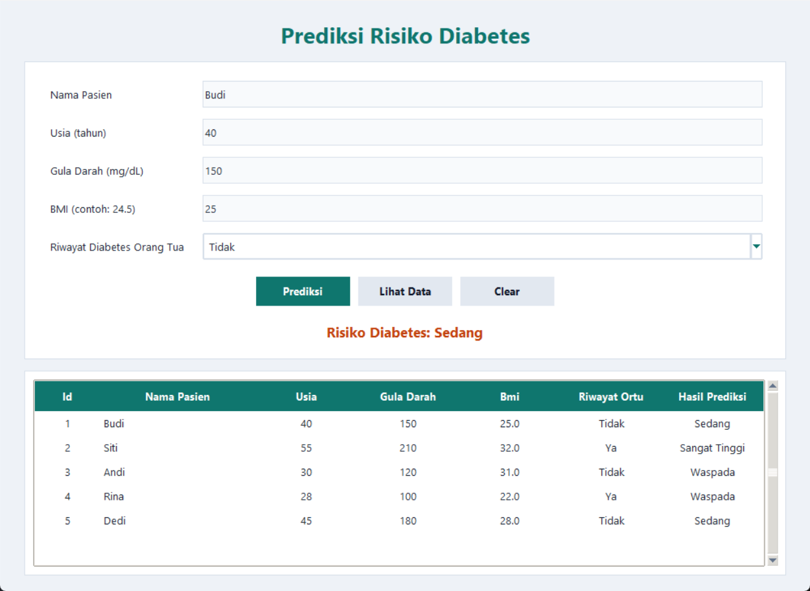

# Prediksi Risiko Diabetes

Aplikasi desktop sederhana berbasis **Python**, **Tkinter**, dan **SQLite** untuk memperkirakan tingkat risiko diabetes berdasarkan kadar gula darah, BMI (Body Mass Index), dan riwayat diabetes orang tua.

Aplikasi ini dibuat untuk keperluan pembelajaran mata kuliah Pemrograman Multipplatform. Hasil prediksi bersifat edukatif dan **bukan diagnosis medis**.



---

## Daftar Isi

- [Gambaran Aplikasi](#gambaran-aplikasi)
- [Fitur](#fitur)
- [Teknologi yang Digunakan](#teknologi-yang-digunakan)
- [Struktur Proyek](#struktur-proyek)
- [Persyaratan Sistem](#persyaratan-sistem)
- [Instalasi](#instalasi)
- [Cara Menjalankan](#cara-menjalankan)
- [Cara Menggunakan Aplikasi](#cara-menggunakan-aplikasi)
- [Aturan Prediksi](#aturan-prediksi)
- [Validasi Input](#validasi-input)
- [Struktur Database](#struktur-database)
- [Contoh Aplikasi / Contoh Data](#contoh-aplikasi--contoh-data)
- [Alur Program](#alur-program)
- [Peta Fungsi](#peta-fungsi)
- [Kustomisasi Tampilan](#kustomisasi-tampilan)
- [Backup dan Reset Database](#backup-dan-reset-database)
- [Troubleshooting](#troubleshooting)
- [Build Menjadi EXE (Windows)](#build-menjadi-exe-windows)
- [Tentang APK Android](#tentang-apk-android)
- [Catatan Akademik dan Disclaimer](#catatan-akademik-dan-disclaimer)
- [Lisensi](#lisensi)

---

## Gambaran Aplikasi

Pengguna mengisi data pasien melalui form, memilih riwayat diabetes orang tua, lalu menekan tombol **Prediksi**. Aplikasi akan:

1. Memvalidasi seluruh input.
2. Menghitung tingkat risiko dengan aturan yang sudah ditentukan.
3. Menyimpan data pasien ke database SQLite.
4. Menampilkan hasil prediksi pada label berwarna.
5. Mengosongkan form agar siap dipakai untuk input berikutnya.

Data yang tersimpan dapat dilihat kembali pada tabel di bagian bawah aplikasi melalui tombol **Lihat Data**.

Aplikasi ini adalah aplikasi **desktop**, bukan aplikasi Android. Penjelasan lebih lanjut ada di bagian [Tentang APK Android](#tentang-apk-android).

---

## Fitur

- Form input:
  - Nama pasien
  - Usia (tahun)
  - Gula darah (mg/dL)
  - BMI
  - Riwayat diabetes orang tua (`Ya` / `Tidak`)
- Validasi input dengan pesan peringatan yang jelas.
- Prediksi risiko dengan lima tingkat:
  - Rendah
  - Waspada
  - Sedang
  - Tinggi
  - Sangat Tinggi
- Hasil prediksi ditampilkan dengan warna berbeda untuk setiap tingkat.
- Penyimpanan data permanen menggunakan SQLite.
- Tabel data pasien dengan kolom lengkap dan scrollbar vertikal.
- Tombol **Clear** untuk mengosongkan form.
- Tampilan menggunakan font, warna, padding, dan style `ttk` yang lebih rapi.
- Tidak membutuhkan library eksternal. Hanya `tkinter`, `ttk`, `messagebox`, dan `sqlite3`.

---

## Teknologi yang Digunakan

| Teknologi | Fungsi |
|---|---|
| Python 3 | Bahasa pemrograman utama |
| Tkinter | Pembuatan window dan widget dasar |
| ttk | Widget Combobox, Treeview, Scrollbar, dan styling |
| sqlite3 | Penyimpanan data lokal |
| SQLite | Database file tunggal `prediksi_diabetes.db` |

Versi Python yang digunakan saat pengujian: **Python 3.14.7** di Windows. Aplikasi tetap dapat berjalan pada Python 3.8+ selama Tkinter tersedia.

---

## Struktur Proyek

```text
TkinterSQLite_0157/
├── app.py                 # Seluruh kode aplikasi (satu file)
├── prediksi_diabetes.db   # Database SQLite, dibuat otomatis saat pertama dijalankan
├── contoh-aplikasi.png    # Screenshot contoh tampilan aplikasi
└── README.md              # Dokumentasi ini
```

File `__pycache__/` dapat muncul setelah aplikasi dijalankan. Folder tersebut dibuat otomatis oleh Python untuk menyimpan bytecode dan aman untuk dihapus.

---

## Persyaratan Sistem

### Minimum

- Python 3.8 atau lebih baru.
- Tkinter (biasanya sudah termasuk dalam instalasi Python resmi).
- SQLite (sudah termasuk dalam modul standar Python).
- Sistem operasi desktop: Windows, Linux, atau macOS.

### Windows

Gunakan installer Python resmi dari <https://www.python.org/downloads/> dan pastikan opsi berikut dicentang saat instalasi:

- `Add Python to PATH`
- `tcl/tk and IDLE`

### Linux (Debian/Ubuntu)

```bash
sudo apt update
sudo apt install python3 python3-tk
```

### Linux (Fedora)

```bash
sudo dnf install python3 python3-tkinter
```

### macOS

Gunakan installer Python dari python.org. Instalasi tersebut sudah menyertakan Tkinter.

### Cek Ketersediaan Tkinter

```bash
python -c "import tkinter, sqlite3; print('Tkinter dan SQLite siap digunakan')"
```

Jika perintah tersebut berhasil, aplikasi siap dijalankan.

---

## Instalasi

1. Pastikan Python dan Tkinter sudah terpasang.
2. Letakkan `app.py` di dalam satu folder.
3. Tidak ada proses `pip install` yang diperlukan karena aplikasi hanya memakai modul standar Python.
4. Jalankan aplikasi satu kali. File `prediksi_diabetes.db` akan dibuat otomatis beserta tabel `pasien`.

---

## Cara Menjalankan

Buka terminal atau Command Prompt, masuk ke folder proyek, lalu jalankan:

```bash
python app.py
```

Atau di Windows:

```powershell
py app.py
```

Jika muncul error `python` tidak dikenali, gunakan `py` atau jalankan Python melalui installer yang sudah ditambahkan ke PATH.

Database akan dibuat secara otomatis pada direktori kerja saat aplikasi dijalankan. Agar database selalu berada di folder proyek, jalankan aplikasi dari dalam folder proyek:

```bash
cd TkinterSQLite_0157
python app.py
```

---

## Cara Menggunakan Aplikasi

1. Jalankan `app.py`.
2. Isi **Nama Pasien**, misalnya `Budi`.
3. Isi **Usia**, misalnya `40`.
4. Isi **Gula Darah** dalam mg/dL, misalnya `150`.
5. Isi **BMI**, misalnya `25` atau `24,5` (koma dan titik sama-sama diterima).
6. Pilih **Riwayat Diabetes Orang Tua**: `Ya` atau `Tidak`.
7. Klik tombol **Prediksi**.
8. Hasil akan muncul pada label, misalnya:

   ```text
   Risiko Diabetes: Sedang
   ```

9. Data otomatis tersimpan ke database dan form dikosongkan.
10. Klik **Lihat Data** untuk menampilkan seluruh data pasien pada tabel.
11. Klik **Clear** jika ingin mengosongkan form tanpa memproses prediksi.

### Perilaku Penting

- Tombol **Prediksi** langsung menyimpan data, menampilkan hasil, lalu mengosongkan form.
- Tabel tidak otomatis diperbarui setelah prediksi. Klik **Lihat Data** untuk memuat data terbaru.
- Label hasil prediksi tetap menampilkan hasil terakhir sampai ada prediksi baru.
- Tombol **Clear** hanya mengosongkan form. Tombol ini **tidak menghapus data** di database.
- Setiap klik **Prediksi** akan menambah satu baris baru. Aplikasi belum memiliki fitur edit atau hapus data.

---

## Aturan Prediksi

Fungsi `hitung_risiko(gula, bmi, riwayat)` menggunakan urutan kondisi berikut.

| Kadar Gula Darah | BMI | Riwayat Orang Tua | Hasil |
|---|---|---|---|
| `>= 200` | Berapa pun | `Ya` | Sangat Tinggi |
| `>= 200` | Berapa pun | `Tidak` | Tinggi |
| `140 - 199` | `>= 30` | `Ya` atau `Tidak` | Tinggi |
| `140 - 199` | `< 30` | `Ya` | Tinggi |
| `140 - 199` | `< 30` | `Tidak` | Sedang |
| `< 140` | `>= 30` | `Ya` | Sedang |
| `< 140` | `>= 30` | `Tidak` | Waspada |
| `< 140` | `< 30` | `Ya` | Waspada |
| `< 140` | `< 30` | `Tidak` | Rendah |

### Bentuk Keputusan

```text
Jika gula >= 200:
    Jika riwayat == "Ya" -> Sangat Tinggi
    Selain itu            -> Tinggi

Jika 140 <= gula < 200:
    Jika bmi >= 30 atau riwayat == "Ya" -> Tinggi
    Selain itu                           -> Sedang

Jika gula < 140:
    Jika bmi >= 30:
        Jika riwayat == "Ya" -> Sedang
        Selain itu            -> Waspada
    Selain itu:
        Jika riwayat == "Ya" -> Waspada
        Selain itu            -> Rendah
```

### Warna Hasil Prediksi

| Hasil | Kode Warna |
|---|---|
| Rendah | `#15803d` |
| Waspada | `#a16207` |
| Sedang | `#c2410c` |
| Tinggi | `#dc2626` |
| Sangat Tinggi | `#7f1d1d` |

---

## Validasi Input

Semua validasi berada di fungsi `read_form()` dan menggunakan `messagebox.showwarning`.

| Data | Aturan Validasi | Judul Pesan | Isi Pesan |
|---|---|---|---|
| Semua field | Tidak boleh kosong | `Missing data` | `Semua data harus diisi.` |
| Nama | Hanya huruf dan spasi | `Invalid name` | `Nama hanya boleh berisi huruf.` |
| Usia | Angka bulat 1 sampai 120 | `Invalid age` | `Usia harus angka 1 sampai 120.` |
| Gula darah | Angka bulat 20 sampai 600 | `Invalid glucose` | `Gula darah harus angka 20 sampai 600 mg/dL.` |
| BMI | Angka 10 sampai 60 | `Invalid BMI` | `BMI harus angka 10 sampai 60.` |

Catatan:

- Nama `Budi Santoso` valid karena spasi diperbolehkan.
- Nama `Budi123` tidak valid karena mengandung angka.
- BMI `24,5` dan `24.5` sama-sama diterima.
- Combobox riwayat bersifat `readonly`, sehingga pengguna hanya bisa memilih `Ya` atau `Tidak`.

---

## Struktur Database

Nama file database:

```text
prediksi_diabetes.db
```

Nama tabel:

```text
pasien
```

Skema tabel:

```sql
CREATE TABLE IF NOT EXISTS pasien (
    id INTEGER PRIMARY KEY AUTOINCREMENT,
    nama_pasien TEXT NOT NULL,
    usia INTEGER,
    gula_darah INTEGER,
    bmi REAL,
    riwayat_ortu TEXT,
    hasil_prediksi TEXT
);
```

| Kolom | Tipe | Keterangan |
|---|---|---|
| `id` | INTEGER | Primary key, bertambah otomatis |
| `nama_pasien` | TEXT | Nama pasien, wajib diisi |
| `usia` | INTEGER | Usia dalam tahun |
| `gula_darah` | INTEGER | Kadar gula darah dalam mg/dL |
| `bmi` | REAL | Nilai BMI |
| `riwayat_ortu` | TEXT | `Ya` atau `Tidak` |
| `hasil_prediksi` | TEXT | Hasil risiko yang disimpan |

Database dibuat otomatis saat aplikasi pertama kali dijalankan melalui fungsi `init_db()`.

Data dapat diperiksa langsung dengan SQLite CLI:

```bash
sqlite3 prediksi_diabetes.db "SELECT * FROM pasien;"
```

Atau melalui Python:

```bash
python -c "import sqlite3; print(sqlite3.connect('prediksi_diabetes.db').execute('SELECT * FROM pasien').fetchall())"
```

---

## Contoh Aplikasi / Contoh Data

### Skenario 1: Hasil Sedang

Input:

| Field | Nilai |
|---|---|
| Nama Pasien | Budi |
| Usia | 40 |
| Gula Darah | 150 |
| BMI | 25 |
| Riwayat Orang Tua | Tidak |

Perhitungan:

- Gula darah `150` berada pada rentang `140 - 199`.
- BMI `25` kurang dari `30`.
- Riwayat orang tua `Tidak`.
- Karena BMI `< 30` dan riwayat `Tidak`, hasilnya **Sedang**.

Output:

```text
Risiko Diabetes: Sedang
```

Data yang tersimpan:

```text
('Budi', 40, 150, 25.0, 'Tidak', 'Sedang')
```

### Skenario 2: Hasil Sangat Tinggi

| Field | Nilai |
|---|---|
| Nama Pasien | Siti |
| Usia | 55 |
| Gula Darah | 210 |
| BMI | 32 |
| Riwayat Orang Tua | Ya |

Hasil: **Sangat Tinggi**, karena gula darah `>= 200` dan riwayat orang tua `Ya`.

### Contoh Data Lengkap

| Nama | Usia | Gula Darah | BMI | Riwayat | Hasil |
|---|---:|---:|---:|---|---|
| Budi | 40 | 150 | 25 | Tidak | Sedang |
| Siti | 55 | 210 | 32 | Ya | Sangat Tinggi |
| Andi | 30 | 120 | 31 | Tidak | Waspada |
| Rina | 28 | 100 | 22 | Ya | Waspada |
| Dedi | 45 | 180 | 28 | Tidak | Sedang |
| Eka | 35 | 130 | 24 | Tidak | Rendah |
| Fajar | 50 | 220 | 27 | Tidak | Tinggi |

Contoh data di atas dapat dimasukkan manual melalui form untuk melihat variasi warna dan hasil prediksi.

---

## Alur Program

```text
Pengguna mengisi form
        |
        v
Klik tombol Prediksi
        |
        v
read_form()
  - mengambil nilai dari entries dan combo_riwayat
  - memvalidasi input
  - mengembalikan data atau None
        |
        v
on_prediksi()
  - memanggil hitung_risiko()
  - menyimpan data dengan add_pasien()
  - memperbarui label_hasil
  - mengosongkan form dengan clear_form()
        |
        v
Klik tombol Lihat Data
        |
        v
refresh()
  - menghapus isi tabel
  - mengambil data dengan get_pasien()
  - menampilkan data ke Treeview
```

---

## Peta Fungsi

| Fungsi | Tanggung Jawab |
|---|---|
| `run_query(sql, params=())` | Membuka koneksi SQLite, menjalankan query, lalu menutup koneksi |
| `init_db()` | Membuat tabel `pasien` jika belum ada |
| `add_pasien(...)` | Menyimpan satu data pasien baru |
| `get_pasien()` | Mengambil seluruh data pasien diurutkan berdasarkan `id` |
| `hitung_risiko(gula, bmi, riwayat)` | Menentukan tingkat risiko sesuai aturan |
| `read_form()` | Membaca dan memvalidasi isi form |
| `on_prediksi()` | Menangani tombol Prediksi |
| `refresh()` | Menangani tombol Lihat Data dan mengisi Treeview |
| `clear_form()` | Mengosongkan semua Entry dan Combobox |

---

## Kustomisasi Tampilan

Semua pengaturan style utama dikumpulkan pada bagian **Style** di dalam blok pembuatan window di `app.py`.

Variabel yang dapat diubah:

| Variabel | Nilai Default | Fungsi |
|---|---|---|
| `BG` | `#eef2f7` | Warna latar window |
| `CARD` | `#ffffff` | Warna latar form dan tabel |
| `BORDER` | `#d8e0ea` | Warna garis tepi |
| `TEXT` | `#1f2937` | Warna teks utama |
| `MUTED` | `#64748b` | Warna teks hasil awal |
| `ACCENT` | `#0f766e` | Warna aksen tombol dan heading |
| `FONT` | `("Segoe UI", 10)` | Font utama |

Ukuran window diatur melalui:

```python
W, H = 1000, 730
X = (root.winfo_screenwidth() - W) // 2
Y = max(0, (root.winfo_screenheight() - H) // 2)
root.geometry(f"{W}x{H}+{X}+{Y}")
```

Style `ttk` untuk Combobox, Treeview, heading tabel, dan scrollbar juga berada di blok yang sama. Perubahan warna hasil prediksi dilakukan melalui dictionary `warna`, dengan syarat setiap tingkat tetap memiliki warna yang berbeda.

---

## Backup dan Reset Database

### Backup

Tutup aplikasi, lalu salin file:

```text
prediksi_diabetes.db
```

ke tempat lain.

### Reset Database

1. Tutup aplikasi.
2. Hapus file `prediksi_diabetes.db`.
3. Jalankan aplikasi kembali.

Aplikasi akan membuat database baru yang kosong secara otomatis.

**Peringatan:** menghapus file database akan menghilangkan seluruh data pasien yang sudah tersimpan.

---

## Troubleshooting

### `ModuleNotFoundError: No module named 'tkinter'`

Tkinter belum terpasang.

- Windows: instal ulang Python dan centang `tcl/tk and IDLE`.
- Ubuntu/Debian: `sudo apt install python3-tk`.
- Fedora: `sudo dnf install python3-tkinter`.

### `'python' is not recognized`

Gunakan:

```bash
py app.py
```

atau tambahkan Python ke PATH saat instalasi.

### Data tidak muncul di tabel setelah Prediksi

Klik tombol **Lihat Data**. Tabel hanya dimuat ulang saat tombol tersebut ditekan.

### Data yang dimasukkan hilang setelah Prediksi

Itu perilaku normal. Setelah prediksi berhasil, form otomatis dikosongkan oleh `clear_form()`, tetapi data sudah tersimpan di database.

### Database tidak ditemukan atau data tidak konsisten

Pastikan aplikasi dijalankan dari folder yang sama dengan file `prediksi_diabetes.db`. Jika dijalankan dari folder lain, SQLite akan membuat database baru di folder tersebut.

### `database is locked`

Biasanya terjadi karena aplikasi dibuka lebih dari satu kali atau file database sedang dipakai proses lain. Tutup semua instance aplikasi, lalu jalankan kembali.

### BMI dengan koma tidak diterima

Aplikasi mendukung koma dan titik, misalnya `24,5` atau `24.5`. Pastikan tidak ada spasi atau karakter lain di dalam angka.

### Nama ditolak padahal terlihat benar

Nama hanya boleh berisi huruf dan spasi. Angka, tanda baca, atau simbol akan ditolak.

### Aplikasi tidak bisa diedit atau data dihapus

Versi ini hanya memiliki fitur tambah dan lihat data. Fitur edit dan hapus belum tersedia.

---

## Build Menjadi EXE (Windows)

Aplikasi Tkinter dapat dikemas menjadi file `.exe` menggunakan PyInstaller. Langkah ini opsional dan tidak mengubah kode aplikasi.

```bash
pip install pyinstaller
pyinstaller --noconfirm --onefile --windowed --name PrediksiDiabetes app.py
```

Hasil build berada di folder `dist/`:

```text
dist/PrediksiDiabetes.exe
```

Catatan:

- Jalankan `.exe` dari folder yang diinginkan. Database akan dibuat di direktori kerja saat aplikasi dijalankan.
- Jika ingin database selalu berada di folder yang sama dengan `.exe`, jalankan aplikasi dari folder tersebut atau sesuaikan `DB_NAME` menjadi path absolut.
- File `.exe` hanya berjalan di Windows, bukan di Android.

---

## Tentang APK Android

Project ini menggunakan **Tkinter**, yaitu framework GUI untuk aplikasi desktop. Tkinter tidak dapat langsung dibungkus menjadi APK Android.

Jika tujuan akhirnya adalah aplikasi Android, beberapa alternatif yang dapat dipertimbangkan:

- **Kivy** atau **KivyMD** untuk aplikasi Python Android.
- **BeeWare / Briefcase** untuk membangun aplikasi Python multi-platform.
- Menulis ulang aplikasi dengan **Flutter**, **React Native**, atau **Kotlin**.

Untuk kebutuhan tugas ini, bentuk distribusi yang paling sesuai adalah menjalankan `app.py` dengan Python atau mengemasnya menjadi `.exe` untuk Windows.

---

## Catatan Akademik dan Disclaimer

- Aplikasi ini dibuat untuk latihan integrasi Tkinter, validasi form, dan SQLite.
- Aturan prediksi bersifat sederhana dan tidak menggantikan perhitungan medis profesional.
- Hasil prediksi tidak boleh digunakan sebagai dasar diagnosis atau pengobatan.
- Untuk keluhan kesehatan, konsultasikan dengan tenaga medis.

---

## Lisensi

Project ini dibuat untuk keperluan pembelajaran. Silakan digunakan, dipelajari, dan dimodifikasi untuk kebutuhan tugas akademik.
